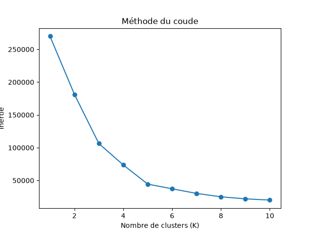
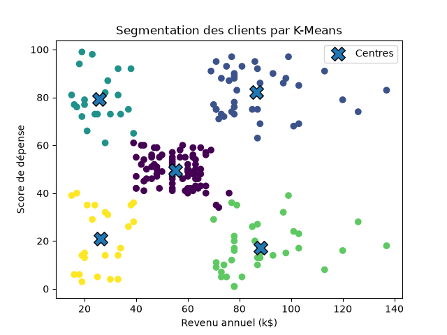
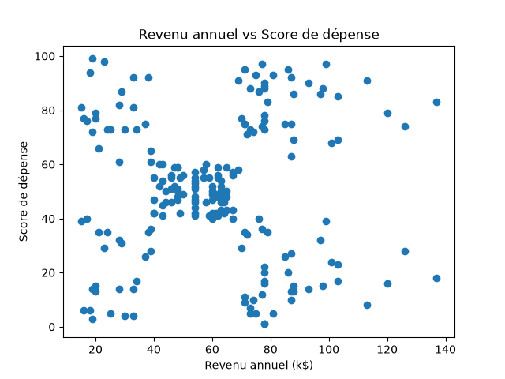

# 📊 Segmentation des clients avec Python et K-Means

## 📌 Présentation du projet

Ce projet consiste à analyser et segmenter des clients à partir de leur revenu annuel et de leur score de dépense.

L'objectif est d'identifier différents profils de clients afin de mieux comprendre leurs caractéristiques et d'aider une entreprise à explorer des pistes d'analyse marketing.

Le projet comprend une analyse exploratoire, une segmentation par apprentissage non supervisé et un dashboard interactif réalisé avec Streamlit.

## 🎯 Objectifs

- Explorer et analyser les données des clients.
- Identifier des groupes de clients présentant des caractéristiques similaires.
- Comparer les profils selon le revenu annuel et le score de dépense.
- Visualiser les résultats à l'aide de graphiques.
- Présenter les résultats dans un dashboard interactif.

## 🛠️ Technologies utilisées

- Python
- Pandas
- Scikit-learn
- Matplotlib
- Streamlit

## 📁 Structure du projet

```text
projet_3_segmentation_clients/
├── analyse.py
├── dashboard.py
├── requirements.txt
├── README.md
├── data/
│   └── Mall_Customers.csv
└── images/
    ├── clusters_clients.png
    ├── methode_du_coude.png
    └── revenu_vs_depense.png
```

## 📊 Données utilisées

Le jeu de données `Mall_Customers.csv` contient 200 clients et cinq colonnes :

- `CustomerID` : identifiant du client.
- `Genre` : genre indiqué dans le jeu de données.
- `Age` : âge du client.
- `Annual Income (k$)` : revenu annuel, exprimé en milliers de dollars.
- `Spending Score (1-100)` : score de dépense fourni par le jeu de données.

Pour la segmentation, les deux variables utilisées sont le revenu annuel et le score de dépense.

## 🤖 Méthode d'analyse

L'algorithme K-Means a été utilisé pour répartir les clients en cinq groupes, selon leurs caractéristiques de revenu et de dépense.

Le choix du nombre de groupes peut être étudié à l'aide de la méthode du coude. Les résultats sont ensuite représentés graphiquement afin de faciliter leur interprétation.

## 🔎 Résultats de la segmentation

| Cluster | Nombre de clients | Revenu annuel moyen (k$) | Score de dépense moyen |
|---|---:|---:|---:|
| 0 | 81 | 55,30 | 49,52 |
| 1 | 39 | 86,54 | 82,13 |
| 2 | 22 | 25,73 | 79,36 |
| 3 | 35 | 88,20 | 17,11 |
| 4 | 23 | 26,30 | 20,91 |

Ces groupes présentent des profils différents. Par exemple, le cluster 1 associe un revenu moyen élevé à un score de dépense élevé, tandis que le cluster 3 associe un revenu moyen élevé à un score de dépense faible.

Ces observations décrivent les données disponibles ; elles ne permettent pas, à elles seules, de connaître les motivations individuelles des clients.

## 📈 Visualisations

### 1. Méthode du coude

Cette méthode permet d'étudier le nombre de clusters à retenir pour la segmentation.



### 2. Segmentation des clients

Ce graphique présente les groupes de clients identifiés par l'algorithme K-Means.



### 3. Revenu annuel et score de dépense

Ce graphique permet de visualiser la répartition des clients selon leur revenu annuel et leur score de dépense.



## 🖥️ Fonctionnalités du dashboard

Le dashboard Streamlit permet de :

- consulter des indicateurs clés ;
- sélectionner un cluster ou afficher tous les clients ;
- filtrer le tableau des clients ;
- visualiser les groupes sélectionnés ;
- consulter une interprétation du profil choisi ;
- télécharger les données filtrées en CSV ;
- afficher et télécharger un discours de présentation adapté au groupe sélectionné.

## ⚙️ Installation et exécution

### 1. Cloner le dépôt

Après publication du projet sur GitHub, remplacez `VOTRE_DEPOT` par l'adresse réelle du dépôt :

```bash
git clone https://github.com/Aliettekukele/VOTRE_DEPOT.git
cd VOTRE_DEPOT
```

### 2. Installer les dépendances

```bash
python -m pip install -r requirements.txt
```

### 3. Lancer le dashboard

```bash
streamlit run dashboard.py
```

Le navigateur affichera ensuite le dashboard interactif.

## 💡 Compétences développées

- Nettoyage et exploration de données avec Pandas.
- Segmentation de clients avec K-Means.
- Visualisation de données avec Matplotlib.
- Création d'un dashboard interactif avec Streamlit.
- Interprétation et présentation de résultats analytiques.

## 👩‍💻 Auteur

**Aliettekukele**

Projet personnel de formation en analyse de données.
